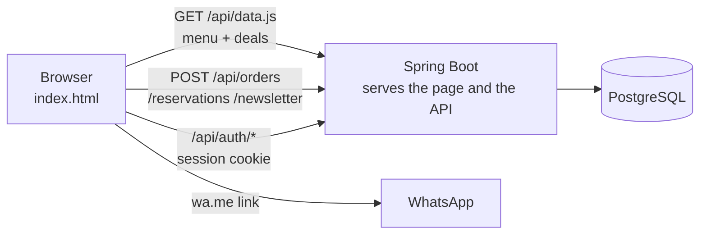
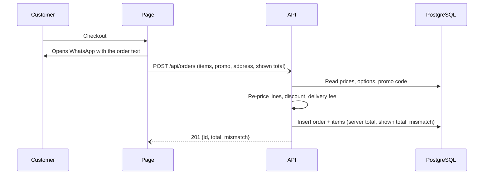
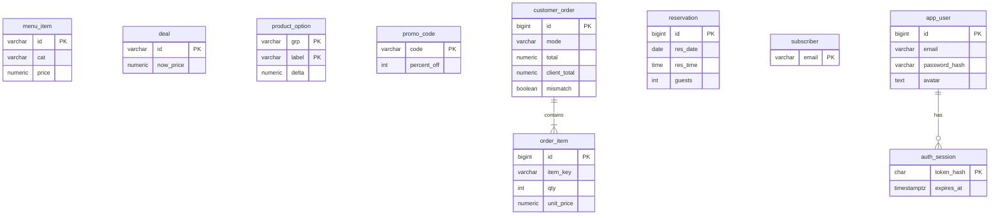

# Premium Boulangerie


A luxury bakery website with a real backend: menu and deals served from PostgreSQL, orders re-priced on the server, table reservations, newsletter sign-ups and e-mail accounts with profile photos.


<!-- After pushing, add the CI badge (replace YOUR-USER):
 -->

The front end is a single hand-written page (HTML, CSS and vanilla JavaScript, English and Arabic with RTL). The back end is a Spring Boot application that also serves that page, so the whole project is one container plus one database.

## Features

**Website**
- Animated hero, menu with categories, coffee bar with size and milk options, custom roll-box builder, deals, bag drawer
- Delivery or pick-up, promo code, free delivery over $25
- Table / box pick-up reservations with date-aware time slots
- Order and chat buttons that open WhatsApp
- English and Arabic (RTL), respects `prefers-reduced-motion`

**Backend**
- Menu and deals stored in PostgreSQL and delivered to the page unchanged (same field names the page already used)
- Every order is **re-priced on the server** from the database: coffee sizes and milks, box size and toppings, deals, promo code and delivery fee. The server's total is stored next to the total the browser showed, and `mismatch` flags any difference
- Reservations are validated against the opening hours and the same 30-minute slots the page offers
- Newsletter sign-ups (duplicates ignored)
- E-mail + password accounts: BCrypt hashes, random session tokens (only their SHA-256 is stored), HttpOnly SameSite=Lax cookie, rate limiting on login and sign-up, optional profile photo shown in the header
- Flyway migrations, Docker multi-stage build, health endpoint

If the backend is unreachable (page opened as a file, GitHub Pages, server down) the page still works: it falls back to the data embedded in `index.html`, and its API calls fail silently.

## Tech stack

| Layer | Technology |
|---|---|
| Front end | HTML, CSS, vanilla JavaScript (no build step) |
| Back end | Java 21, Spring Boot 3.5 (Web, JDBC, Validation, Actuator), `spring-security-crypto` (BCrypt) |
| Database | PostgreSQL 16, Flyway migrations |
| Packaging | Maven, Docker (multi-stage), Docker Compose |
| CI | GitHub Actions (Maven build and Docker build) |

## Architecture



The order flow keeps the page in charge of the customer experience (the order still goes out through WhatsApp) while the backend keeps an authoritative record:



## Quick start

Requirements: Docker Desktop (or Docker Engine with the Compose plugin).

```bash
git clone https://github.com/YOUR-USER/premium.git
cd premium
cp .env.example .env        # then set POSTGRES_PASSWORD (and TZ)
docker compose up -d --build
```

Open http://localhost:8080. Flyway creates the tables and loads the menu on first start.

```bash
docker compose logs -f app   # follow the application log
docker compose down          # stop (data is kept in the pgdata volume)
docker compose down -v       # stop and delete the database
```

### Configuration

| Variable (`.env`) | Default | Meaning |
|---|---|---|
| `POSTGRES_DB` | `premium` | database name |
| `POSTGRES_USER` | `premium` | database user |
| `POSTGRES_PASSWORD` | required | database password |
| `TZ` | `UTC` | bakery time zone, used to reject reservations in the past (e.g. `Europe/Moscow`) |

Application settings live in `src/main/resources/application.yml`: `premium.delivery-fee` and `premium.free-delivery-over` (keep them equal to `FEE` and `FREE` in `index.html`).

> The compose file publishes PostgreSQL on `127.0.0.1:5432` for tools such as DBeaver. If that port is taken, change only the **left** number (for example `127.0.0.1:5433:5432`). The right number and `DB_URL` must stay `5432`.

### Run without Docker for the app

```bash
docker compose up -d db
DB_PASSWORD=<your POSTGRES_PASSWORD> mvn spring-boot:run     # PowerShell: $env:DB_PASSWORD="..."
```

## Project structure

```
premium/
├── docker-compose.yml          # app + PostgreSQL
├── Dockerfile                  # Maven build, then a slim JRE image
├── pom.xml
├── .env.example
├── .github/workflows/ci.yml
├── docs/frontend.md            # notes on the original front-end project
└── src/main/
    ├── java/com/premium/
    │   ├── PremiumApplication.java
    │   ├── PremiumProperties.java     # delivery fee, free-delivery threshold, time zone
    │   ├── MenuController.java        # /api/menu, /api/deals, /api/data.js
    │   ├── OrderController.java       # POST /api/orders (DTOs + validation)
    │   ├── OrderService.java          # server-side pricing and persistence
    │   ├── ContactController.java     # reservations, newsletter
    │   ├── AuthController.java        # register, login, logout, me, avatar
    │   ├── RateLimiter.java
    │   ├── ApiException.java / ApiErrors.java
    └── resources/
        ├── application.yml
        ├── db/migration/              # V1 schema, V2 seed, V3 accounts
        └── static/                    # index.html and assets/
```

## API

All bodies are JSON. Errors look like `{"error": "<code>"}`; validation errors are `{"error":"validation","fields":{...}}`.

| Method and path | Purpose |
|---|---|
| `GET /api/data.js` | `window.PREMIUM_DATA = { menu, deals }`, loaded by the page before its script (cached 30 s) |
| `GET /api/menu`, `GET /api/deals` | the same data as JSON |
| `POST /api/orders` | store an order, returns the server-computed totals |
| `POST /api/reservations` | store a reservation |
| `POST /api/newsletter` | store an e-mail, `204` |
| `POST /api/auth/register`, `POST /api/auth/login` | create an account / sign in, sets the session cookie |
| `GET /api/auth/me` | current user, or `401` |
| `POST /api/auth/logout` | end the session, `204` |
| `PUT /api/auth/avatar` | set or remove (`null`) the profile photo (data URL, jpeg/png/webp, up to 100 kB) |
| `GET /actuator/health` | health check |

### Orders

Cart keys are the ones the page already uses: `"<menuId>|"`, `"<coffeeId>|Medium, Whole"`, `"deal|<dealId>"`, `"box|4 rolls, Vanilla cream, Pecans"`.

```bash
curl -X POST http://localhost:8080/api/orders -H "Content-Type: application/json" -d '{
  "mode": "delivery", "address": "Moscow, Tverskaya 1", "promo": "WELCOME10", "lang": "en",
  "clientTotal": 20.15,
  "items": [
    {"key": "cream|", "qty": 2, "price": 6.5, "label": "", "name": "Vanilla Cream Swirl"},
    {"key": "flat|Large, Oat", "qty": 1, "price": 5.5, "label": "Large, Oat", "name": "Flat White"}
  ]
}'
```

```json
{"id": 1, "subtotal": 18.50, "discount": 1.85, "deliveryFee": 3.50, "total": 20.15, "mismatch": false}
```

An unknown item or option returns `400`. Browser prices are never trusted: only `qty` and the key matter for the stored total.

### Reservations and newsletter

```bash
curl -X POST http://localhost:8080/api/reservations -H "Content-Type: application/json" \
  -d '{"name":"Sara","phone":"+79990000000","date":"2026-11-20","time":"10:30","guests":2,"type":"Table"}'

curl -X POST http://localhost:8080/api/newsletter -H "Content-Type: application/json" \
  -d '{"email":"sara@example.com"}'
```

On Windows PowerShell use `curl.exe` and put the JSON in a file (`-d "@body.json"`), or use Git Bash.

### Accounts

```bash
curl -c jar.txt -X POST http://localhost:8080/api/auth/register -H "Content-Type: application/json" \
  -d '{"name":"Sara","email":"sara@example.com","password":"at-least-8-chars"}'
curl -b jar.txt http://localhost:8080/api/auth/me
```

Codes: `email_taken` (409), `invalid_credentials` (401), `too_many_attempts` (429, 10 attempts per 10 minutes per IP), `validation` (400).

## Database



Useful queries:

```bash
docker compose exec db psql -U premium -d premium -c \
  "select id, mode, total, client_total, mismatch, created_at from customer_order order by id desc limit 20"
docker compose exec db psql -U premium -d premium -c \
  "select name, res_date, res_time, guests, kind from reservation order by res_date, res_time"
docker compose exec db psql -U premium -d premium -c "select email, created_at from subscriber"
docker compose exec db psql -U premium -d premium -c "select email, name, created_at from app_user"
```

## Customising

| To change | Where |
|---|---|
| WhatsApp number | `const WA` in `src/main/resources/static/index.html` (digits only, with country code) |
| Address, phone, e-mail | the "Visit us" block in `index.html` (and its Arabic text in the `AR` dictionary) |
| Prices, items, deals | tables `menu_item` and `deal`, for example `update menu_item set price = 7.00 where id = 'cream'` (the page caches for 30 s) |
| Coffee / box option prices | table `product_option` (the page's own option markup must match) |
| Promo codes | table `promo_code`; the page itself only recognises `WELCOME10` when a code is typed |
| Opening hours | `sched` in `index.html` and `SCHED` in `ContactController` (keep them equal) |

After editing files under `src/main/resources`, rebuild: `docker compose up -d --build`.

## Security notes

- Passwords are hashed with BCrypt; session tokens are random 256-bit values, stored only as SHA-256; the cookie is HttpOnly and SameSite=Lax (and `Secure` automatically over HTTPS).
- SQL uses parameterised queries throughout. User-supplied names and e-mails are escaped before they are inserted into the page.
- Never commit `.env`; it is listed in `.gitignore`. Use a long random database password anywhere outside your own machine.
- Behind a reverse proxy, the rate limiter sees the proxy's address. Configure forwarded headers or limit at the proxy.

**Before going public:** put the app behind HTTPS (Caddy or Nginx), keep the database port unpublished, and replace the demo contact details.

## Roadmap

- Admin page for orders and reservations
- Password reset and e-mail verification
- Link orders to signed-in users ("My orders")
- Notifications (e-mail or WhatsApp Business API) from the server
- Automated tests (pricing rules, reservations, auth)

## License

MIT, see [LICENSE](LICENSE). The photographs in `src/main/resources/static/assets/` are part of the original demo project; make sure you have the right to publish them, or replace them with your own.
